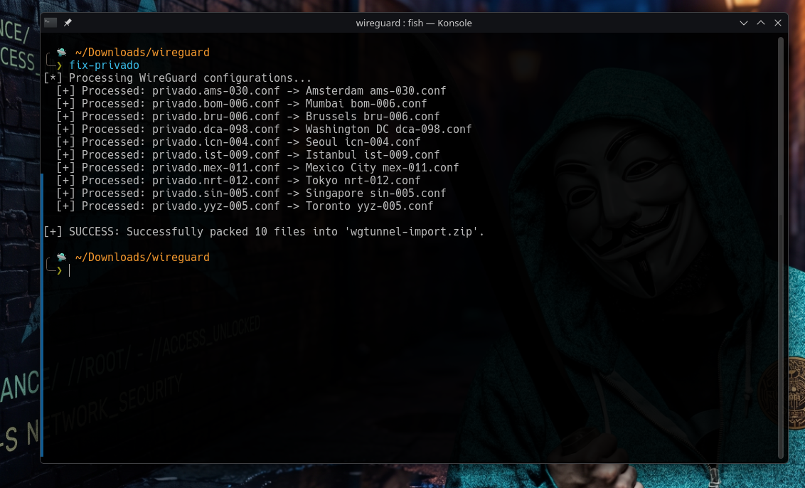

# PrivadoVPN WireGuard / AmneziaWG Toolchain
<p align="center">
  
</p>
Automated toolchain to download, sanitize, patch, and package PrivadoVPN WireGuard profiles with AmneziaWG obfuscation for WG Tunnel.

---

## Features
- Automated Web Panel Downloader: Downloads your 10 preferred server profiles in seconds.
- De-branding & Standard Naming: Strips privado prefixes and names files cleanly (e.g. Amsterdam ams-033.conf).
- AmneziaWG Obfuscation: Injects parameters (Jc=4, Jmin=40, Jmax=70, H1-H4, S1-S2, MTU=1280).
- High Performance DNS: Sets resolvers to 1.1.1.1 and 8.8.8.8 with PersistentKeepalive = 25.
- One-Click Packaging: Automatically generates wgtunnel-import.zip ready for import.
- Auto Cleanup: Removes configurations older than 3 days.

---

## Installation (Arch Linux / Linux)

Run this command to install the CLI tool:

sudo curl -sSL https://raw.githubusercontent.com/Irmb7108/privado-wg-tool/main/fix-privado -o /usr/local/bin/fix-privado && sudo chmod +x /usr/local/bin/fix-privado

---
## Browser Automation Setup (Auto-Downloader)
You can automate the download of all 10 profiles using the code stored in privado-downloader.js. Choose either method below:

##Method 1: One-Click Bookmarklet (Recommended)
Open privado-downloader.js and copy its entire raw code.

Show your browser bookmarks bar (Ctrl + Shift + B).

Right-click the bar and choose Add Page (or Add Bookmark).

Set the Name to: ⚡ Download 10 Privado

In the URL field, type javascript: and immediately paste the copied code after it.

Click Save. When on the PrivadoVPN WireGuard panel, simply click this bookmark to start downloading.

## Method 2: DevTools Snippets (Console)
Open the PrivadoVPN WireGuard panel and press F12.

Go to the Sources tab, click the >> icon in the left pane, and choose Snippets.

Click + New snippet, name it privado-downloader, and paste the contents of privado-downloader.js.

Press Ctrl + S to save.

Press Ctrl + Enter anytime you want to run the script and download all configs.

---

## How to Use

1. Log into your PrivadoVPN dashboard and navigate to the WireGuard section:
   https://app.privadovpn.com/en/admin-panel
2. Click your browser bookmarklet and let it download the 10 profiles.
3. Open your terminal in the directory where files are downloaded and execute:
   fix-privado
4. Import wgtunnel-import.zip directly into WG Tunnel.

---

## CLI Options

fix-privado -h : Show help and usage details
fix-privado -v : Show version
fix-privado -c : Clean output folder and zip file


## WG Tunnel Installation & Service Management
Installation (Arch Linux / CachyOS)
Install WG Tunnel directly from the AUR using your preferred helper:
```bash
yay -S wgtunnel-bin
```
Service Management (Systemd)
Start and enable the background daemon service:
```bash
sudo systemctl start wgtunnel
```
